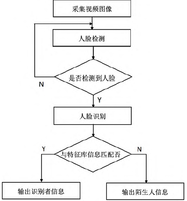

# 复杂文档解析系统的双栏性能测试方法

# A Two-Column Benchmark for Complex Document Parsing

文档性能测试课题组

摘要：为统一评估版面、文字、表格、公式和流程图模型，本文构造内容一致的原生PDF与扫描PDF。

关键词：文档解析；文字识别；表格识别；公式识别；流程图识别；推理性能

# 1 引言

文档解析系统需要同时处理正文段落、统计表格、数学公式以及流程图等多种内容。不同文件虽然视觉相同，但原生PDF具有字符层，扫描PDF仅包含像素信息，因此两种输入会触发不同的文字处理路径。为了获得可复现的性能数据，测试页面应固定尺寸、版式、分辨率和元素位置，并分别记录整页耗时与各模型耗时。

# 2 流程图识别任务

身份识别系统首先采集视频图像并进行人脸检测。检测成功后提取人脸特征，并与特征库中的模板进行匹配；匹配成功则输出识别者信息，匹配失败则输出陌生人信息。

*图1 身份识别系统流程图*

流程图中包含处理框、判断框、箭头和闭环分支，可用于验证节点检测、线段检测以及图中文字识别是否被正确触发。对扫描文件而言，图外正文还需要经过文字检测与识别。

# 3 公式识别任务

公式区域选取含有变量、上标、减号、括号与不等号的独立数学表达式。该区域用于验证公式检测和公式识别模型，并检查输出是否能够保持原有符号结构

$$
\Delta = 4(a + 1)^2 - 4(a^2 - 1) \geq 0
$$

式（1）判别式计算公式

判别式大于或等于零表示方程存在实数解。原生版本中公式本身保持为论文截图，周围解释文字保留字符层；扫描版本则将整页栅格化，从而保持视觉内容一致。

# 4 对照测试设计

原生PDF允许直接提取标题、摘要和正文文字，扫描PDF则需要执行OCR检测与识别。两份文件均为单页A4双栏布局，表格、公式和流程图的位置完全一致。测试时应先完成模型加载和预热，再分别统计整页纯推理时间、端到端时间以及每个实际调用模型的累计时间。

# 5 评价指标

整页性能采用秒每页和页每分钟表示；文字识别同时报告字符错误率，表格报告TEDS，公式报告CDM或规范化LaTeX准确率，流程图报告节点与连线的准确率。只有质量不下降时，速度提升才具有可比性。

# 6 表格识别任务

<table border=1><tr><td rowspan="2"></td><td colspan="2">Univariate Analysis</td><td colspan="2">Multivariate Analysis</td></tr><tr><td>p Value</td><td>HR (95% CI)</td><td>p Value</td><td>HR (95% CI)</td></tr><tr><td>Age, years</td><td>&lt;0.001</td><td>1.046 (1.021-1.072)</td><td>&lt;0.001</td><td>1.053 (1.024-1.084)</td></tr><tr><td>Valvular heart disease</td><td>0.026</td><td>0.509 (0.281-0.921)</td><td>0.003</td><td>0.392 (0.212-0.723)</td></tr><tr><td>Chronic pulmonary disease</td><td>0.002</td><td>0.405 (0.230-0.714)</td><td>&lt;0.001</td><td>0.228 (0.116-0.451)</td></tr><tr><td>Creatinine</td><td>&lt;0.001</td><td>1.025 (1.014-1.036)</td><td></td><td></td></tr><tr><td>Hemoglobin</td><td>&lt;0.001</td><td>0.961 (0.945-0.977)</td><td></td><td></td></tr><tr><td>NT-proBNP/100</td><td>&lt;0.001</td><td>1.013 (1.009-1.017)</td><td>0.032</td><td>1.006 (1.001-1.011)</td></tr><tr><td>CRP</td><td>&lt;0.001</td><td>1.264 (1.172-1.363)</td><td></td><td></td></tr><tr><td>Albumin</td><td>&lt;0.001</td><td>0.809 (0.756-0.866)</td><td>0.001</td><td>0.875 (0.809-0.947)</td></tr><tr><td>CAR × 100</td><td>&lt;0.001</td><td>1.095 (1.068-1.123)</td><td>0.008</td><td>1.043(1.011-1.077)</td></tr><tr><td>LVEF, %</td><td>&lt;0.001</td><td>0.958 (0.940-0.976)</td><td>&lt;0.001</td><td>0.942 (0.917-0.968)</td></tr><tr><td>NYHA III-IV, n (%)</td><td>0.020</td><td>0.037(0.002-0.595)</td><td></td><td></td></tr><tr><td>ACEI/ARB</td><td>&lt;0.001</td><td>2.742 (1.556-4.830)</td><td></td><td></td></tr><tr><td>Beta-blocker</td><td>0.005</td><td>2.106 (1.257-3.530)</td><td>0.008</td><td>2.167(1.225-3.833)</td></tr></table>

*表1 全因死亡预测因素的单因素与多因素回归分析*

表格包含多级表头、数值列、置信区间、缺失单元格和特殊符号，可同时考察表格定位、结构恢复与单元格文字识别。该单页样本覆盖了File2MD主要模型路径，适合作为板卡和运行时的快速回归基准。